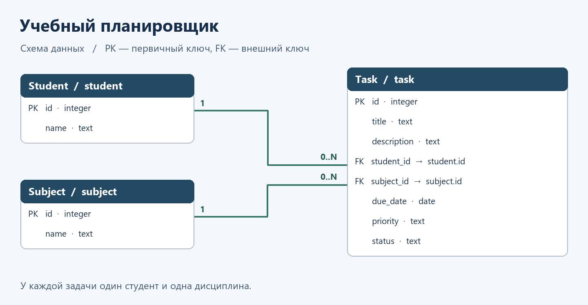

# Информационная система: Веб-сайт для планирования учебных задач студентов

**Курс:** Прикладное программное обеспечение информационных систем (2026 г.)  
**Автор:** Студент группы ИС-24А — Нурболат Арайлым

## 1. Описание предметной области

Студент выбирает своё имя и видит задания по дисциплинам. Планировщик показывает ближайшие сроки и отдельно считает невыполненные задачи с уже прошедшим сроком. Студент может найти задание по части названия, перенести дедлайн, изменить приоритет, отметить выполнение и удалить запись. При первом запуске база получает примеры для трёх студентов, чтобы все эти действия можно было показать сразу.

## 2. Архитектура данных (ER-диаграмма)



| Таблица | Что хранит | Связи |
|---|---|---|
| `student` | ID и имя студента | Один студент может иметь несколько задач |
| `subject` | ID и название дисциплины | По одной дисциплине можно поставить несколько задач |
| `task` | ID, название, описание, срок, приоритет, статус, ID студента и дисциплины | `student_id → student.id` и `subject_id → subject.id` обязательны |

## 3. Технологический стек

- **Backend:** Python 3.11+, FastAPI, Uvicorn. Pydantic проверяет тело запроса, Swagger UI показывает схему API.
- **Database / ORM:** SQLite, SQLModel и SQLAlchemy.
- **Frontend UI:** Streamlit и Requests. Интерфейс получает данные через HTTP.
- **DevOps / Инфраструктура:** Docker, Docker Compose, Git. Для локальных коммитов использована Python-библиотека Dulwich.
- **AI-tools (вспомогательные инструменты):** OpenAI Codex использован для написания кода и тестов, проверки проекта и подготовки материалов защиты.

## 4. Инструкция по локальному развертыванию

### Предварительные требования

Для контейнерного запуска нужен работающий Docker Desktop с Linux-контейнерами и Docker Compose. Для запуска в VS Code нужен установленный Python с модулем `venv`. На Windows рекомендуется Python 3.11 или 3.12 x64. При первой установке пакетов и сборке образов нужен интернет.

### Шаги для запуска

**1. Откройте проект.** Если файлы уже на ноутбуке, откройте папку проекта в VS Code и выберите «Терминал → Создать терминал». Команды ниже выполняются в PowerShell из папки с этим README. Чтобы получить опубликованный проект на другом компьютере, подставьте свой логин GitHub и имя репозитория.

```powershell
$login = 'ВАШ_ЛОГИН'
$repo = 'applied-is-project-2026'
git clone "https://github.com/$login/$repo.git"
Set-Location $repo
```

**2. Запустите оба сервиса через Docker.** Если локальные серверы уже запущены, остановите их клавишами Ctrl+C в обоих терминалах.

```powershell
docker compose up --build
```

**3. Откройте планировщик и Swagger.** Адреса на ноутбуке — [планировщик](http://localhost:8501) и [Swagger UI](http://localhost:8000/docs). В начальной базе 3 студента, 3 дисциплины и 5 задач. Даты примеров отсчитываются от дня создания базы. Если показываете проект спустя несколько дней, создайте задачу с будущей датой.

Состояние контейнеров можно увидеть во втором терминале командой `docker compose ps`. Для проверки сохранения данных создайте задачу и запомните ID, выполните `docker compose down`, затем `docker compose up -d` и найдите тот же ID. Именованный том `planner_data` хранит файл `/data/database.db`. Ключ `-v` при остановке удаляет том вместе с данными. При запуске из VS Code используется отдельный файл `database.db` в корне проекта.

### Запуск из VS Code без Docker

В подготовленной папке уже есть рабочая `.venv` с Python 3.12. Для показа сразу выполните последние команды первого и второго терминалов. Следующая последовательность предназначена для новой копии проекта.

**Первый терминал — подготовка и FastAPI.** Команда `python --version` должна показать выбранный Python. Если установлено несколько версий и есть Windows Python Launcher, для создания окружения можно ввести `py -3.12 -m venv .venv`.

```powershell
python --version
python -m venv .venv
.\.venv\Scripts\python.exe -m pip install -r requirements.txt
.\.venv\Scripts\python.exe seed.py
.\.venv\Scripts\python.exe -m uvicorn app.main:app --host 127.0.0.1 --port 8000
```

**Второй терминал — Streamlit.** Оставьте первый терминал открытым. В VS Code нажмите «+» на панели терминала и выполните из той же папки:

```powershell
.\.venv\Scripts\python.exe -m streamlit run app/frontend/ui.py --server.address=127.0.0.1 --server.port=8501
```

Откройте те же два адреса в браузере. Остановить каждый процесс можно клавишами Ctrl+C. В уже подготовленном окружении для следующего показа нужны только команды запуска Uvicorn и Streamlit. Прямой путь к интерпретатору работает без активации окружения. Для ручной активации в каждом терминале доступна команда `.\.venv\Scripts\Activate.ps1`. Для демонстрации SQL задайте `$env:SQL_ECHO = '1'` перед запуском бэкенда.

### Ручная проверка в Swagger

Откройте метод, нажмите **Try it out**, заполните поля и нажмите **Execute**. Сначала выполните `GET /students` и `GET /subjects`. В новой базе ID Арайлым и дисциплины «Базы данных» равны 1. Подставьте выбранные ID в тело `POST /tasks` и при необходимости замените срок на ближайший будущий день.

```json
{
  "title": "Сдать отчёт по базам данных",
  "description": "Приложить ER-диаграмму.",
  "student_id": 1,
  "subject_id": 1,
  "due_date": "2026-12-01",
  "priority": "Высокий",
  "status": "В работе"
}
```

Ответ **201** содержит новый `id`. У `GET /tasks` укажите `search=отчёт`, `student_id=1`, `subject_id=1`, `status=В работе`; для приведённого примера границы `due_from=2026-12-01` и `due_to=2026-12-01` включают сам день. В форме Swagger вводите только значение каждого параметра. Выполните `PATCH /tasks/{id}` с телом `{"due_date":"2026-12-08"}`, затем `GET /tasks/{id}` и сверьте поля. После `DELETE /tasks/{id}` ответ **204** пуст, повторный GET вернёт **404**. Для примера **422** отправьте POST с названием из одних пробелов.

### Публикация на GitHub

Установите Git for Windows, если команда `git --version` недоступна. В своём аккаунте GitHub создайте **пустой публичный** репозиторий, например `applied-is-project-2026`. README и .gitignore уже входят в локальную историю. Из папки проекта проверьте `git remote -v`. Если вывод пуст, выполните:

```powershell
$login = 'ВАШ_ЛОГИН'
$repo = 'applied-is-project-2026'
git remote add origin "https://github.com/$login/$repo.git"
git push -u origin main
```

Замените `ВАШ_ЛОГИН` своим логином, а `applied-is-project-2026` — фактическим именем, если выбрали другое. Пройдите вход в GitHub и проверьте, что на странице видны README, схема и история. Если `origin` уже указывает на нужный адрес, достаточно команды push. Для просмотра истории используйте `git log --oneline --date=short --format="%h %ad %s"`.

## 5. Запуск тестов

В PowerShell из корня проекта с установленными зависимостями выполните:

```powershell
.\.venv\Scripts\python.exe -m pytest -q
```

Каждый тест получает временную SQLite-базу через `tmp_path`. В тестах проверяются создание и чтение, частичное изменение, сохранение остальных полей, поиск на русском языке, совместные фильтры, удаление, ошибки 404 и 422 и повторный посев. Критерии, ответы на вопросы и сценарий демонстрации собраны в [памятке для защиты](DEFENSE.md).
